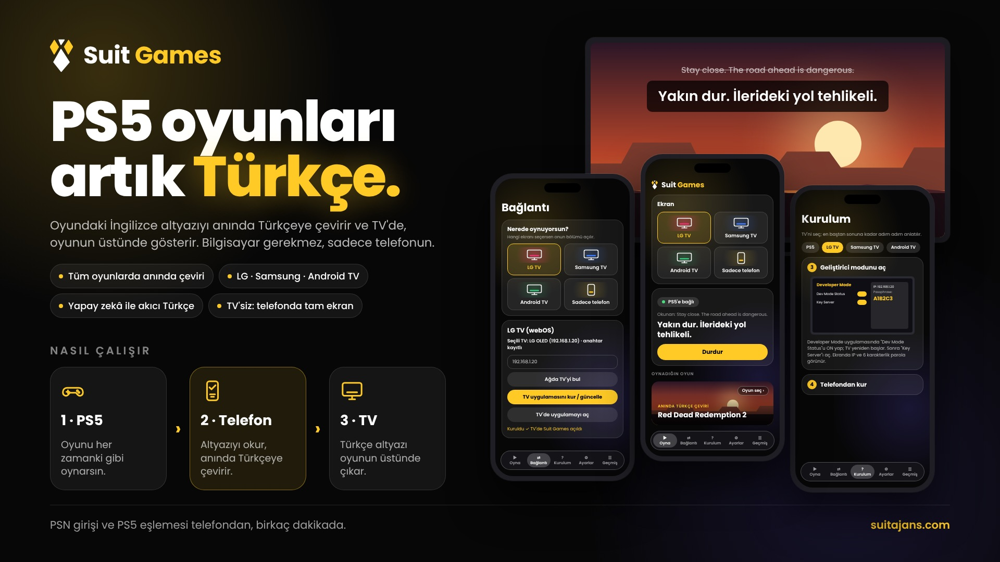
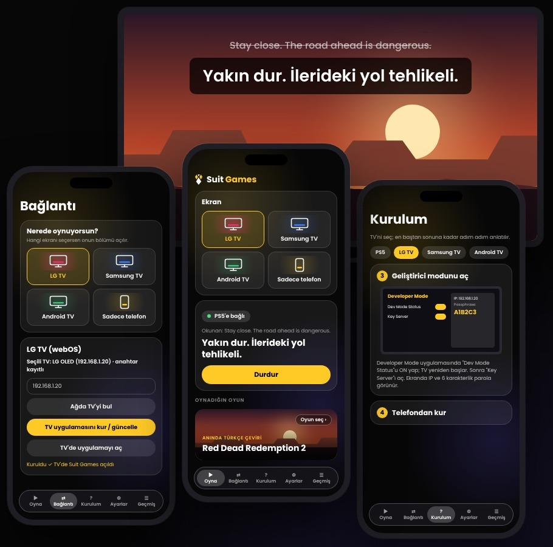

  

<h1 align="center">Suit Games</h1>

  <b>PS5 oyunları artık Türkçe.</b> 
  Oynadığın her oyunun İngilizce altyazısını anında Türkçeye çevirir ve TV'de, oyunun üstünde gösterir.

  
  

  

## Tüm oyunlar, anında Türkçe

Suit Games **her oyunda** çalışır. Oyun ekranda İngilizce konuşurken çeviri saniyeler içinde TV'nde, oyunun hemen üstünde Türkçe olarak belirir. Oyuna ve PS5'e dokunmadan, bilgisayar gerekmeden; sadece telefonunla.

- **Anlık çeviri:** Altyazı ekrana düştüğü an Türkçesi TV'de.
- **Doğal Türkçe:** Yapay zekâ ile akıcı, oyunun havasına uygun çeviri.
- **Her TV'de:** LG, Samsung ve Android TV. TV'n yoksa telefonda tam ekran.
- **Kolay kurulum:** İlk açılışta adım adım sihirbaz, her şey telefondan.

## Nasıl çalışır?

| 1 · PS5 | 2 · Telefon | 3 · TV |
|:---:|:---:|:---:|
| Oyununu her zamanki gibi oynarsın. | Suit Games altyazıyı okur, anında Türkçeye çevirir. | Türkçe altyazı, TV'de oyunun üstünde çıkar. |

## Ekranlar

  

## Desteklenen ekranlar

| Ekran | Kurulum |
|---|---|
| **LG** (webOS) | Uygulama, TV'ye telefondan kurulur |
| **Samsung** (Tizen) | Uygulama, TV'ye telefondan kurulur |
| **Android TV / Google TV** | Uygulama, TV'ye telefondan kurulur |
| **Sadece telefon** | TV'ye bir şey kurulmaz; çeviri telefonda büyük yazıyla görünür |

Her adım, uygulamanın **Kurulum** sekmesinde resimli olarak anlatılır.

## İndir ve kur

1. **[SuitGames.apk dosyasını indir](https://github.com/siberyazilimciarsiv/suit-games/releases/latest/download/SuitGames.apk)** (Android 8 ve üstü).
2. Telefonda dosyayı aç; "bilinmeyen kaynaklara izin ver" sorarsa izin ver ve **Yükle**'ye bas.
3. Uygulamayı aç; ilk açılıştaki sihirbaz seni adım adım kuruluma götürür.

Yeni sürümler çıktığında uygulama içinden haber verilir. Güncellemeler ve destek için Telegram kanalı: **[t.me/suitgames](https://t.me/suitgames)**

Uygulamayı yalnızca bu sayfadan ya da resmi Telegram kanalından indir. Resmi APK'lar Suit Games anahtarıyla imzalıdır; değiştirilmiş kopyalar açılmaz.

## Teşekkür

- [CouchSubs](https://github.com/yorulmazsinan/couchsubs) üzerine kurulmuş bir Android uyarlamasıdır.
- Remote Play: [chiaki-ng](https://github.com/streetpea/chiaki-ng) (AGPL-3.0).
- Çevirilerde topluluk çevirmenlerinin emeğine teşekkür ederiz.
- Oyun adları ve içerikleri ilgili yapımcılarına aittir. Suit Games hiçbir oyun şirketiyle bağlantılı değildir.
